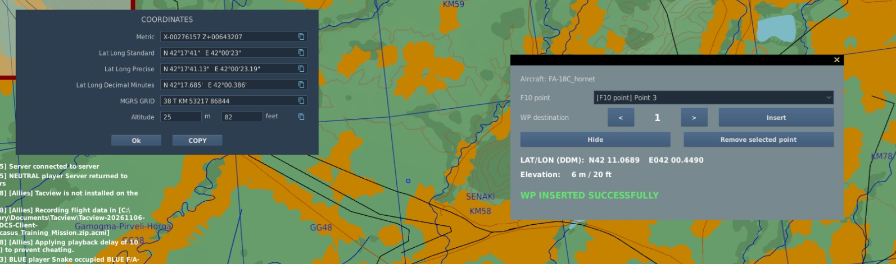

# DCS F10 To Waypoint v1.1.0 — Transfer F10 map points directly into aircraft avionics

DCS F10 To Waypoint (F10W) transfers a position selected on the F10 map directly into the waypoint system of a supported aircraft through a native overlay displayed inside DCS.

The project runs entirely on the DCS client. There is no external application, separate window, background process, .NET dependency, firewall rule, or server-side component.

## Important change from the previous project

F10W works with **points selected on the F10 map**, not with existing map markers.

DCS does not expose a reliable client-side API for enumerating map markers in every multiplayer session. Data available to server-side mission scripting is often unavailable to local client hooks. Because the project must remain completely client-side and independent of mission or server modifications, the previous marker-based approach could not be made consistently reliable.

Version 1.1.0 has therefore been rebuilt around DCS's native F10 coordinate window. This provides the same workflow on compatible single-player and multiplayer missions without depending on blocked mission APIs.

## Workflow

1. Enter a supported aircraft and press `Ctrl + Shift + M` to open the F10W overlay.
2. Open the F10 map. The overlay remains visible over the map.
3. Hold `Left Alt` and left-click the desired position.
4. Press **COPY** in the DCS coordinate window. The point immediately appears in the overlay.
5. Repeat the previous two steps to acquire more points if needed.
6. Return to the cockpit, select the F10 point and destination waypoint, and press **Insert**.

F10W automatically converts the coordinates, reads terrain elevation, and performs the aircraft-specific avionics procedure. The point list, coordinates, elevation, progress, success, and error messages remain visible in the in-game overlay.

## Main features

- Native in-game DCS overlay.
- Automatic point acquisition from the F10 coordinate-window **COPY** action.
- Multiple F10 points available during the current cockpit session.
- Automatic coordinate conversion and terrain elevation.
- Aircraft-specific waypoint ranges and entry procedures.
- Automatic **PRECISE** activation and `LATLN DCML` / `LATLN SEC` detection for the F/A-18C.
- Improved compact UI with clear progress, success, and error states.
- Protection against overlapping avionics sequences.
- No external program or server installation.
- Dedicated diagnostic log.

## Tested aircraft

- F/A-18C Hornet: WP1-WP59.
- F-16C Viper: STPT1-STPT99.
- F-14A/B Tomcat: WP1-WP3.
- F-14B(U): flight-plan WP1-WP3.
- F-4E Phantom II: TARGET1-TARGET2.
- AH-64D Apache: W01-W50.
- Mirage F1EE: WP1-WP9.
- UH-60L mod 2.1.x: WP00-WP69.
- A-4E-C mod: DEST1-DEST2.

## Experimental aircraft

The following integrations are implemented but have not yet been confirmed by a successful user test and may require adjustments:

- A-10C / A-10C II: WP0-WP40.
- AJS-37 Viggen: B1-B9.
- JF-17 Thunder: DST1-DST49.
- Mirage 2000C: PREP1-PREP20.
- AV-8B N/A Harrier: WP1-WP99.
- F-15E Strike Eagle: A1-A99.

## Demonstration video

https://www.youtube.com/watch?v=nI1SDAzudL4

## Download and documentation

Download ZIP:  
https://github.com/FabryAngio/DCS_F10ToWaypoint/archive/refs/heads/main.zip

Documentation and source:  
https://github.com/FabryAngio/DCS_F10ToWaypoint

Bug reports, test results, and aircraft requests:  
https://github.com/FabryAngio/DCS_F10ToWaypoint/issues

DCS F10 To Waypoint is an independent community project and is not affiliated with, endorsed by, or supported by Eagle Dynamics.

Copyright © 2026 FabryAngio. All rights reserved. Personal, non-commercial use of the original and unmodified software is permitted. Modification, redistribution, republication, sale, derivative works, or integration into other projects requires prior written permission.
