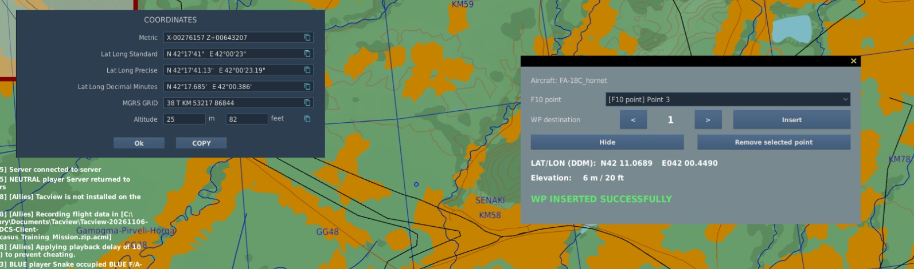

# DCS F10 To Waypoint

**DCS F10 To Waypoint (F10W) 1.1.0** transfers a point selected on the DCS F10 map directly into the waypoint system of a supported aircraft.

It runs entirely inside DCS through a native in-game overlay. There is no external application, separate window, .NET dependency, background process, or firewall rule.

## Demonstration video

[](https://www.youtube.com/watch?v=nI1SDAzudL4)



## How it works

1. Enter a supported aircraft and press **Ctrl + Shift + M** to open the F10W overlay.
2. Open the F10 map. The overlay remains visible.
3. Hold **Left Alt** and left-click the desired position.
4. In the DCS coordinate window, press **COPY**. The new point immediately appears in the overlay.
5. Repeat the previous two steps if you want to acquire more points.
6. Return to the cockpit, select the F10 point and destination waypoint, and press **Insert**.
7. Do not operate the avionics until F10W reports success or an error.

The point is acquired automatically when DCS copies its coordinates. Keeping the overlay open lets you see every point appear in real time. The overlay also shows its `LAT/LON (DDM)` coordinates and terrain elevation before insertion.

## Important: points, not map markers

F10W 1.1.0 works with **positions selected on the F10 map**. It does not list or import DCS map markers.

DCS does not provide local client hooks with a reliable API for enumerating existing map markers in every multiplayer session. Server-side mission scripting can access data that may not exist in the client environment, but F10W is intentionally client-only and requires no server installation. For consistent operation on different servers, F10W uses the coordinates copied by DCS's own F10 coordinate window.

## Features

- Native overlay displayed directly inside DCS.
- Automatic acquisition from the DCS F10 coordinate-window **COPY** button.
- Multiple acquired F10 points can be kept in the list during the current cockpit session.
- Automatic coordinate conversion and terrain-elevation lookup.
- Module-specific waypoint ranges and avionics procedures.
- Automatic **PRECISE** activation and `LATLN DCML` / `LATLN SEC` detection for the F/A-18C.
- Clear progress, success, and error states; coordinates remain visible during insertion.
- Insert locking prevents overlapping avionics sequences.
- Improved, compact user interface.
- Client-only operation: no server component and no mission modification.
- Dedicated diagnostic log.

## Supported aircraft

Tested support:

- F/A-18C Hornet: WP1-WP59.
- F-16C Viper: STPT1-STPT99.
- F-14A/B Tomcat: WP1-WP3.
- F-14B(U): flight-plan WP1-WP3.
- F-4E Phantom II: TARGET1-TARGET2.
- AH-64D Apache: W01-W50.
- Mirage F1EE: WP1-WP9.
- UH-60L mod 2.1.x: WP00-WP69.
- A-4E-C mod: DEST1-DEST2.

Experimental support is implemented but has not yet been confirmed by a successful user test:

- A-10C / A-10C II: WP0-WP40.
- AJS-37 Viggen: B1-B9.
- JF-17 Thunder: DST1-DST49.
- Mirage 2000C: PREP1-PREP20.
- AV-8B N/A Harrier: WP1-WP99.
- F-15E Strike Eagle: A1-A99.

Experimental integrations may require adjustments. Test reports and aircraft requests are welcome through [GitHub Issues](https://github.com/FabryAngio/DCS_F10ToWaypoint/issues).

## Automatic installation

1. Download and extract the [latest ZIP](https://github.com/FabryAngio/DCS_F10ToWaypoint/archive/refs/heads/main.zip).
2. Close DCS completely.
3. Double-click **`Install-F10W.cmd`**.
4. Start DCS and follow the workflow above.

Administrator privileges are not required. The installer detects `Saved Games\DCS` or `Saved Games\DCS.openbeta`, preserves existing `Export.lua` integrations such as SRS and Tacview, and backs up every existing file that it changes.

Run the same installer again to update F10W. Version 1.1.0 also removes superseded DCS Marker To Waypoint files so that only one overlay and one Export bridge are loaded.

When migrating from the previous release, the installer also removes the exact default `mission`/`scripting` permission line that the old reader added. Customized `net.allow_dostring_in` lists are preserved.

For a custom Saved Games location:

```powershell
powershell.exe -NoProfile -ExecutionPolicy Bypass -File .\Install.ps1 -SavedGamesDcs "D:\Path\To\DCS"
```

## Manual installation

See [MANUAL_INSTALLATION.md](MANUAL_INSTALLATION.md). Manual installation requires copying two Lua files and adding one managed line to `Export.lua`.

## Usage guide

See [USER_GUIDE.md](USER_GUIDE.md) for the complete workflow, status messages, module notes, and troubleshooting.

## Logs

- `Saved Games\DCS\Logs\F10W.log`
- `Saved Games\DCS\Logs\dcs.log` — search for `F10W.GUI` or `F10W`

## Uninstallation

Close DCS and double-click **`Uninstall-F10W.cmd`**. The uninstaller removes only F10W files and managed loader lines; backups are preserved.

## License

Copyright © 2026 FabryAngio. All rights reserved.

Personal, non-commercial use of the original, unmodified software is permitted. Modification, redistribution, republication, sale, derivative works, and integration into other projects require prior written permission. See [LICENSE](LICENSE).

DCS F10 To Waypoint is an independent community project and is not affiliated with, endorsed by, or supported by Eagle Dynamics.
